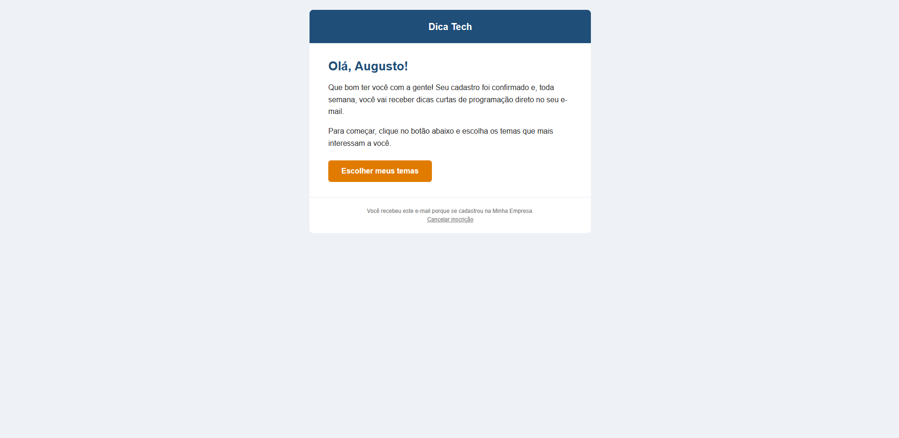
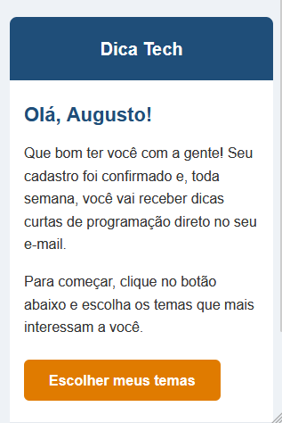

# E-mail HTML responsivo com personalização

E-mail de boas-vindas da newsletter fictícia **Dica Tech**, feito em HTML e CSS, com layout responsivo e saudação personalizada (`Olá, {nome}!`).

## Arquivos

- `email.html`: modelo do e-mail, com o placeholder `{nome}`
- `personalizar.py`: script em Python que troca o `{nome}` pelo nome do destinatário e gera o `email_personalizado.html`
- `prints/`: capturas de tela das versões desktop e celular

## Como usar

1. Rode o script:
   ```bash
   python personalizar.py
   ```
2. Digite o nome do destinatário.
3. Abra o `email_personalizado.html` no navegador.

## O que foi aplicado

- Layout com tabelas (padrão para compatibilidade com clientes de e-mail)
- CSS inline, com `<style>` apenas para a media query
- Responsividade com `@media (max-width: 600px)`
- Texto de pré-visualização (preheader)
- Botão de chamada para ação
- Rodapé com link de cancelamento de inscrição

## Prints

### Desktop


### Celular
